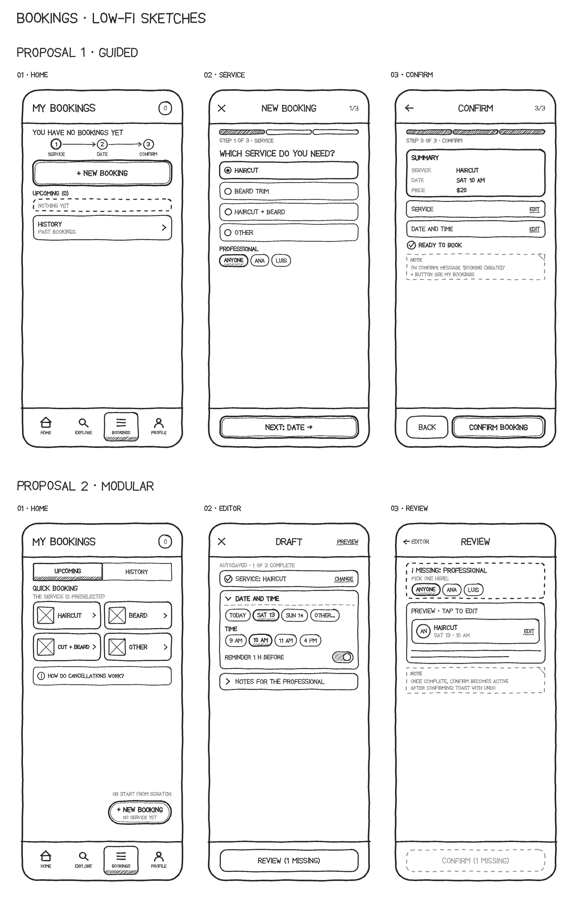

# lowfi-sketch-wireframes

Hand-drawn, **low-fidelity mobile wireframes generated from Python**. You describe each screen in a few lines; the library draws it with wobbly strokes, hand lettering and hatching, then builds side-by-side comparison sheets.



It is built to **explore structure and flow, not visual design**. That makes it handy for UX coursework, early product exploration, or comparing two alternative solutions to the same flow. It also ships as a **Claude Agent Skill** (`SKILL.md`), so an AI agent can produce consistent wireframes for any project.

## Features

- No coordinates needed: a `Screen` stacks components top to bottom.
- 40+ sketch components: header, fields, radios, checkboxes, chips, tabs, steppers, progress, accordions, cards, list items, alerts, design notes, footer CTAs, tab bar, FAB, bottom sheet…
- Hand lettering drawn stroke by stroke, so **no fonts are required**. Supports Spanish accents and common punctuation.
- Any number of alternative proposals per flow (2 by default; as a skill, the agent asks you how many).
- `render_project()` writes one PNG per screen (375 × 812 by default, any size supported) plus comparison sheets for each proposal and for all of them.
- Built-in checks: content overflow, characters without a glyph, exact image size.

## Quick start

```bash
pip install -r requirements.txt
OUT=./out python3 scripts/template_project.py
```

```python
from lowfi_kit import Screen, render_project

def home(s):
    s.header("My bookings", chip="0")
    s.steps(["Service", "Date", "Confirm"])
    s.button("+ New booking", "pri", h=56)
    s.list_item("History", "Past bookings")
    s.nav([("home", "Home"), ("list", "Bookings"), ("user", "Profile")], 1)

render_project({"Proposal_1_Guided": [("01_Home", home)]}, "out", "My project")
```

Output:

```
out/
├── Proposal_1_Guided/01_Home.png
└── Comparison/Proposal_1_Full.png
```

See [`SKILL.md`](SKILL.md) for the full API, the visual rules and the UX guidelines for comparing proposals.

## Using it as a Claude skill

Copy this folder into your skills directory (for example `~/.claude/skills/lowfi-sketch-wireframes/`) or upload it as a custom skill. Claude will follow `SKILL.md` whenever you ask for low-fi or hand-drawn wireframes.

## Repository layout

```
SKILL.md                 skill instructions (API, rules, workflow)
scripts/lowfi_kit.py     Screen layout API + render_project()
scripts/sketch.py        wobbly drawing primitives and icons
scripts/hand.py          hand lettering, hatching, placeholder bars
scripts/template_project.py   example with two proposals
examples/                rendered examples
```

## Requirements

Python 3.8+ and Pillow.
